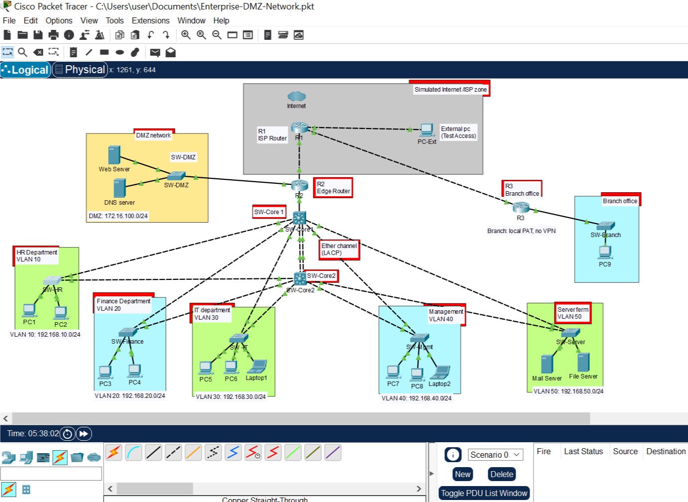
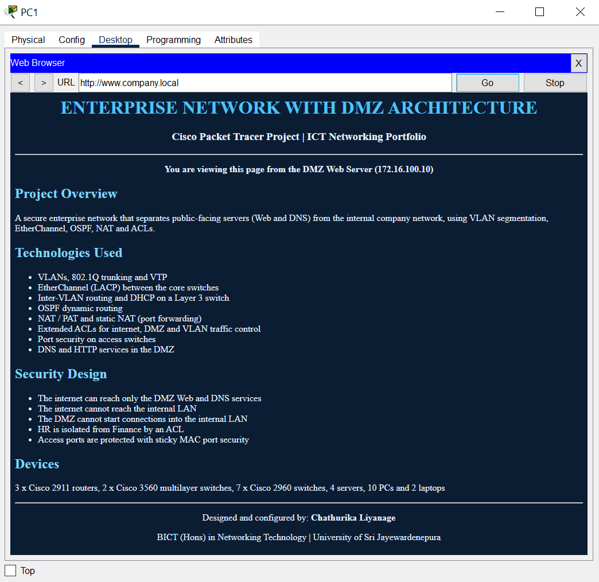
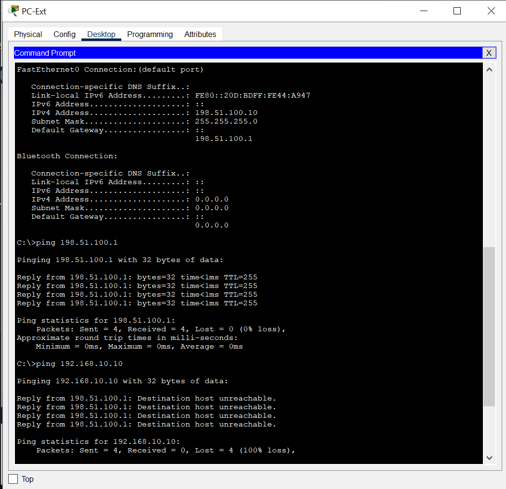
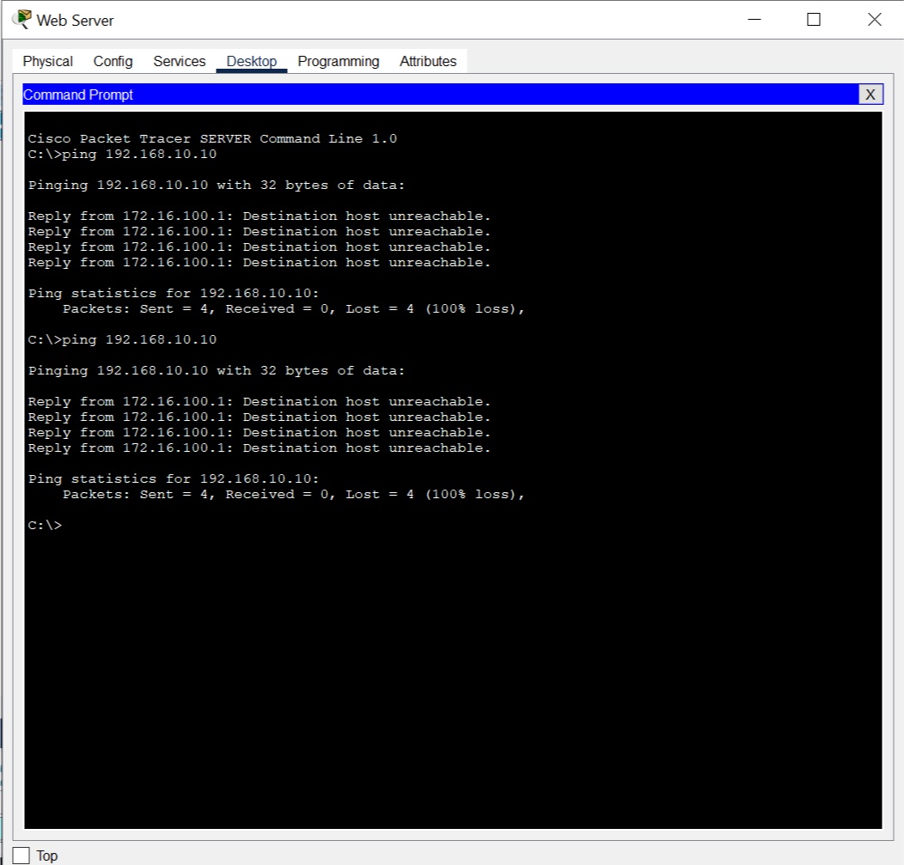
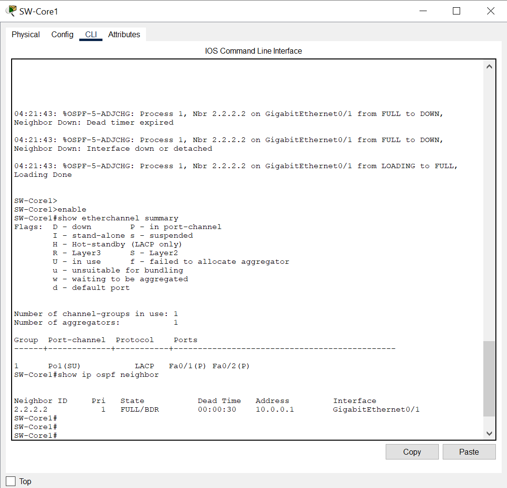
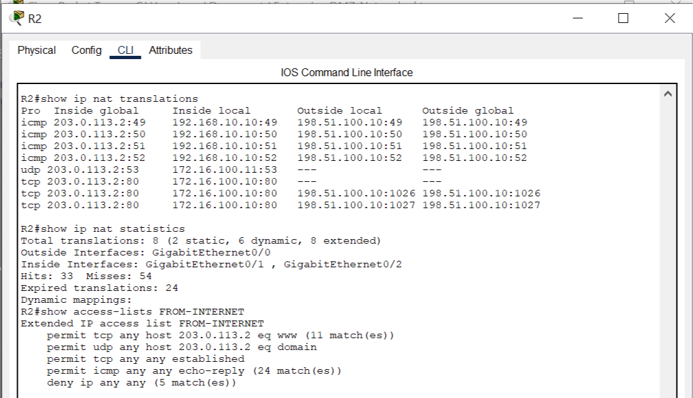
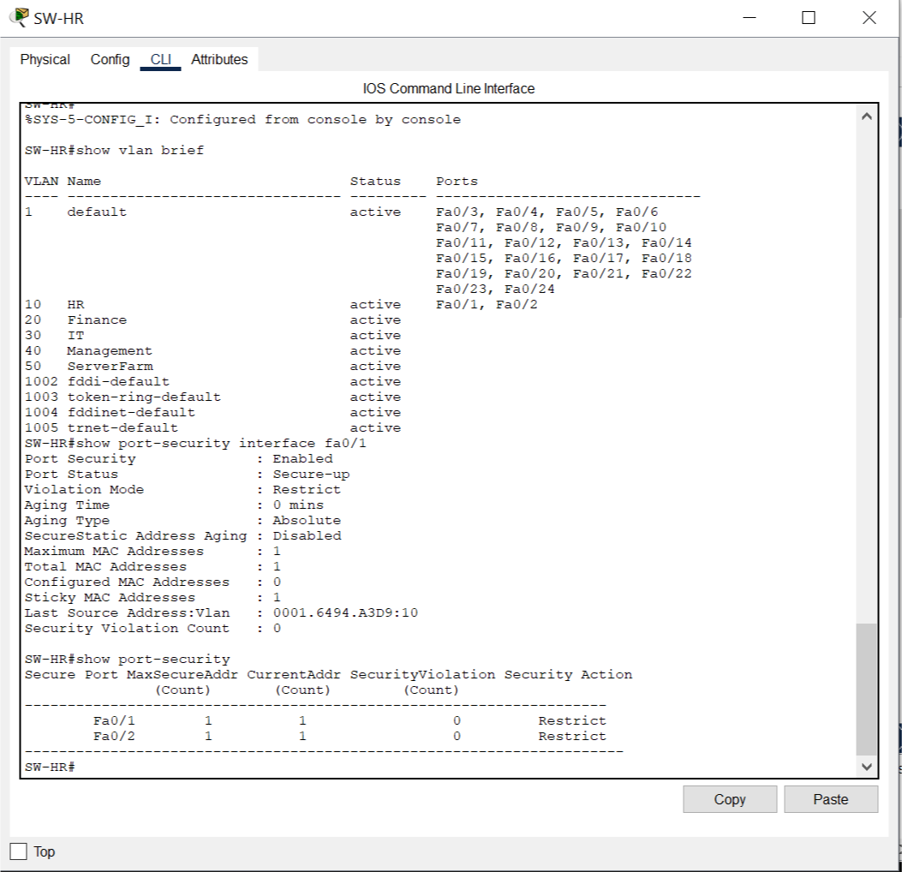

# Enterprise Network with DMZ Architecture

A secure multi-zone enterprise network designed and configured in **Cisco Packet Tracer**. The main goal is to separate public-facing servers (Web and DNS) from the internal company network, using VLAN segmentation, EtherChannel, OSPF, NAT and ACLs.



## Features

- **VLAN segmentation:** HR, Finance, IT, Management and Server Farm
- **Trunking and VTP** across the access and core switches
- **EtherChannel (LACP)** between the two core switches
- **Inter-VLAN routing and DHCP** on a Layer 3 switch
- **OSPF** dynamic routing between the core and the edge router
- **NAT / PAT and static NAT** (port forwarding for the DMZ web and DNS servers)
- **Extended ACLs** controlling internet, DMZ and internal traffic
- **DMZ** hosting the Web and DNS servers
- **Port security** (sticky MAC) on access ports
- **Branch office** with its own local PAT internet access

## Network Design

| Zone | Network | Notes |
|---|---|---|
| VLAN 10 (HR) | 192.168.10.0/24 | Isolated from Finance by ACL |
| VLAN 20 (Finance) | 192.168.20.0/24 | |
| VLAN 30 (IT) | 192.168.30.0/24 | |
| VLAN 40 (Management) | 192.168.40.0/24 | |
| VLAN 50 (Server Farm) | 192.168.50.0/24 | |
| DMZ | 172.16.100.0/24 | Web and DNS servers, gateway on R2 Gi0/1 |
| Branch office | 192.168.60.0/24 | Gateway on R3 Gi0/1 |
| R1 to R2 link | 203.0.113.0/30 | Simulated ISP link |
| R1 to R3 link | 203.0.113.4/30 | Simulated ISP link |
| Internet user (PC-Ext) | 198.51.100.0/24 | Simulated internet host |

### Router interfaces

| Device | Interface | Address | Role |
|---|---|---|---|
| R1 (ISP) | Gi0/0 | 203.0.113.1/30 | To R2 |
| R1 (ISP) | Gi0/1 | 203.0.113.5/30 | To R3 |
| R1 (ISP) | Gi0/2 | 198.51.100.1/24 | To PC-Ext |
| R2 (Edge) | Gi0/0 | 203.0.113.2/30 | To ISP, NAT outside, ACL `FROM-INTERNET` |
| R2 (Edge) | Gi0/1 | 172.16.100.1/24 | DMZ gateway, ACL `DMZ-IN` |
| R3 (Branch) | Gi0/0 | 203.0.113.6/30 | To ISP, NAT outside |
| R3 (Branch) | Gi0/1 | 192.168.60.1/24 | Branch LAN, NAT inside |

R1 acts as a plain ISP router and does not route private networks. The Cloud-PT in the topology is only a visual symbol for the Internet.

## Security Design

| Rule | Result |
|---|---|
| Internet to DMZ Web Server (HTTP) | Allowed |
| Internet to internal LAN | Blocked |
| DMZ to internal LAN (new connections) | Blocked |
| HR to Finance | Blocked by ACL |
| Internal users to DMZ website and internet | Allowed |
| Access ports | Sticky MAC port security |

## Test Results

### DMZ website through DNS
Internal users open `http://www.company.local`, resolved by the DNS server in the DMZ.



### Internet blocked from the internal network
PC-Ext cannot reach the internal LAN.



The DMZ Web Server cannot start connections into the LAN.



### EtherChannel and OSPF
LACP bundle `Po1` is up and the OSPF neighbour is in the FULL state.



### NAT and ACL counters
PAT and static NAT translations on R2, with ACL match counters.



### VLANs and port security



## Technologies

Cisco Packet Tracer, 802.1Q, VTP, LACP (EtherChannel), STP, OSPF, DHCP, DNS, HTTP, NAT / PAT, extended ACLs, port security

## Devices

3 x Cisco 2911 routers, 2 x Cisco 3560 multilayer switches, 7 x Cisco 2960 switches, 4 servers, 10 PCs and 2 laptops.

## Repository Structure

```
Enterprise-DMZ-Network/
├── README.md
├── Enterprise-DMZ-Network.pkt
├── images/      screenshots and topology
└── configs/     running configs of R1, R2, R3, SW-Core1, SW-Core2, SW-HR
```

## How to Run

1. Install Cisco Packet Tracer.
2. Open `Enterprise-DMZ-Network.pkt`.
3. Use the PCs, the Web Server and PC-Ext to repeat the tests above.

## Limitations and Future Improvements

- The branch office is isolated from HQ and reaches the internet through local PAT. A GRE tunnel was attempted but was unstable in Packet Tracer, so it was removed.
- Add a **site-to-site VPN (GRE or IPsec)** between HQ and the branch.
- Add redundant edge routers (HSRP) and a second ISP link.
- Add AAA and centralized logging.

## Author

**W.L. Chathurika Madhuwanthi**
BICT (Hons) in Networking Technology
GitHub: [chathurikamadhuwanthi](https://github.com/chathurikamadhuwanthi)
